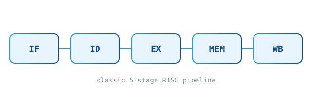

This is a sample post. It's marked `draft: true`, so it shows up in `npm run dev` but never on the
deployed site. Delete it, or flip `draft` to `false`, whenever you like.

## Images

Images live next to the post and are referenced relatively. The text in quotes becomes a caption:



## LaTeX

Inline math sits in the sentence: an ideal $k$-stage pipeline approaches a speedup of $k$, since
$T_{\text{pipelined}} \approx \frac{T_{\text{single}}}{k}$ once it's full.

Display math gets its own line:

$$
\text{Speedup}(n) = \frac{n \cdot k}{k + (n - 1)} \xrightarrow{\;n \to \infty\;} k
$$

## Code

Inline `code`, or fenced blocks:

```c
for (int i = 0; i < n; i++) {
    sum += a[i] * b[i];
}
```

## Tables and more

| Stage | Does                    |
| ----- | ----------------------- |
| IF    | Fetch the instruction   |
| EX    | Execute / compute addr. |
| WB    | Write the result back   |

> Quotes, ~~strikethrough~~, task lists, and footnotes[^1] work too.

- [x] Markdown
- [x] Images
- [x] LaTeX

[^1]: Like this one.
